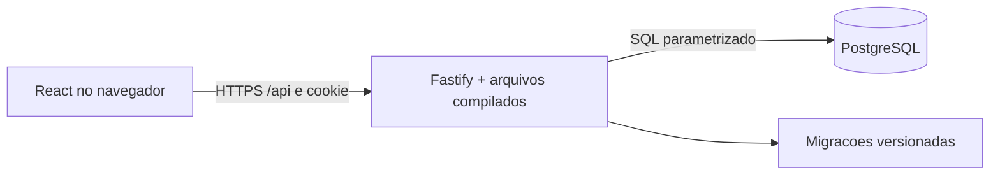

# EntregaLab

Gestao de projetos e tarefas para pequenas equipes da faculdade ou do trabalho. React + TypeScript, API REST Fastify e PostgreSQL, com uma imagem Docker de producao.

## Funcionalidades entregues

- Cadastro, login, sessao em cookie HttpOnly e logout.
- Projetos privados, criacao, edicao e exclusao pelo lider.
- Membros adicionados pelo email de uma conta ja cadastrada.
- Tarefas com titulo, descricao, prioridade, prazo opcional e responsavel.
- Board com quatro estados, arrastar e soltar, reordenacao persistente e controle alternativo por select.
- List com edicao, mudanca de status e exclusao com confirmacao.
- Dashboard com pendentes, concluidas, em revisao, atrasadas, grafico por estado e tarefas por pessoa.
- Busca e filtros por prioridade, responsavel e prazo no Board e na List.
- Comentarios nas tarefas, tema claro/escuro e navegacao mobile.
- Laboratorio com dois projetos, 12 tarefas, membros ficticios e administracao dos exemplos.
- Demonstracao sem cadastro: use `Testar como administrador` na tela de entrada. Cada sessao tem dados privados e dura 24 horas.
- Notificacoes no site para projetos, equipe, tarefas, comentarios e prazos, com leitura e preferencias por categoria.
- Persistencia no PostgreSQL; atualizar ou trocar de dispositivo nao perde os dados.
- Atualizacao do projeto aberto a cada 30 segundos enquanto a pagina estiver visivel, e botao de atualizacao manual.

## Producao no WSL Ubuntu

Pre-requisitos: Docker Engine com Compose disponivel no Ubuntu e Node.js 22.12+ para gerar o arquivo de configuracao. Nesta maquina, o Docker e executado pelo WSL.

Na pasta do projeto, gere segredos uma unica vez:

```powershell
npm run setup:production
```

No terminal Ubuntu:

```bash
cd /mnt/c/Users/daffa/Documents/site_kanban
docker compose --env-file .env.production -f docker-compose.prod.yml up -d --build
docker compose --env-file .env.production -f docker-compose.prod.yml ps
```

Abra http://127.0.0.1:8080 e crie sua conta. http://localhost:8080 tambem funciona onde o encaminhamento localhost do WSL estiver ativo. O projeto inicial fica vazio para receber suas tarefas reais.

A interface e compilada pelo Vite e servida pela API. A execucao de producao nao depende de servidor de desenvolvimento, npm watch ou bind mount de codigo. O container da aplicacao roda sem root, com sistema de arquivos somente leitura. O PostgreSQL nao expoe uma porta publica.

As migracoes sao aplicadas ao iniciar e registradas em `schema_migrations`. O volume `entregalab-production_postgres_data` mantem os dados entre reinicios e novas versoes. Nao use `down -v` em uma instalacao com dados reais.

```bash
# Logs e reinicio
docker compose --env-file .env.production -f docker-compose.prod.yml logs --tail=100 app
docker compose --env-file .env.production -f docker-compose.prod.yml restart app

# Parar sem apagar dados
docker compose --env-file .env.production -f docker-compose.prod.yml down

# Atualizar depois de alterar o codigo
docker compose --env-file .env.production -f docker-compose.prod.yml up -d --build
```

O `restart: unless-stopped` reinicia os containers quando o Docker inicia. A disponibilidade local depende do computador, do WSL e do Docker estarem ativos. Para acesso fora da sua maquina, use o deploy HTTPS descrito em [docs/DEPLOY.md](docs/DEPLOY.md).

## Backup e restauracao

No Ubuntu, com o banco de producao ativo:

```bash
bash scripts/backup.sh
```

O dump fica em `backups/`, fora do controle de versao. Copie os backups para outro local seguro. Para testar a restauracao em um banco separado, substitua o nome do dump pelo arquivo gerado:

```bash
docker compose --env-file .env.production -f docker-compose.prod.yml exec -T postgres createdb -U entregalab entregalab_restore_check
docker compose --env-file .env.production -f docker-compose.prod.yml exec -T postgres pg_restore -U entregalab -d entregalab_restore_check --no-owner < backups/entregalab-AAAAMMDD-HHMMSS.dump
docker compose --env-file .env.production -f docker-compose.prod.yml exec -T postgres psql -U entregalab -d entregalab_restore_check -c 'SELECT count(*) FROM tasks;'
```

Este procedimento nao substitui nem apaga o banco em uso. Dumps incluem dados pessoais e hashes de senha: mantenha acesso restrito.

## Desenvolvimento

```bash
docker compose up --build
```

- Web: http://localhost:5173
- API e health check: http://localhost:3333/health
- PostgreSQL de desenvolvimento: localhost:5432

O Compose de desenvolvimento e o de producao usam nomes e volumes diferentes. Os dados nao sao compartilhados entre essas instalacoes.

Fora do Docker:

```bash
npm ci
cp .env.example .env
npm run dev:api
# Em outro terminal
npm run dev:web
```

O banco precisa estar ativo. Ajuste `DATABASE_URL` em `.env`; a API carrega esse arquivo da raiz e aplica a migracao inicial. O Vite encaminha `/api` para a API local, evitando uma URL fixa de localhost no codigo de producao.

## Testes e verificacao

```bash
npm run typecheck
npm run build
npm audit
docker compose -f docker-compose.test.yml up --build --abort-on-container-exit --exit-code-from tests
docker compose -f docker-compose.test.yml down
```

Os testes usam `node:test`, Fastify `inject` e PostgreSQL real em container separado com armazenamento temporario. O teste recusa um banco cujo nome nao termina em `_test`. Cobrem autenticacao, validacao, isolamento entre projetos, papeis de lider/membro, origens de requisicao, rollback para responsavel invalido, estados, reordenacao, movimentos simultaneos, comentarios, remocao de membros e exclusao em cascata. Um teste adicional usa o cliente HTTP da interface contra um servidor real para verificar criacao, exclusao e logout. A configuracao de CI fica em `.github/workflows/ci.yml`.

## API

Todos os endpoints de produto usam `/api`. O cliente recebe a sessao em cookie HttpOnly, SameSite=Lax, com Secure habilitado no deploy HTTPS. Para clientes REST, preserve o cookie retornado em cadastro/login. Bearer JWT tambem e aceito para clientes internos que possuam um token valido.

| Metodo | Endpoint | Acesso |
| --- | --- | --- |
| POST | `/api/auth/register`, `/api/auth/login` | Publico, com limite de tentativas |
| GET | `/api/auth/me` | Autenticado |
| POST | `/api/auth/logout` | Limpa o cookie |
| GET, POST | `/api/projects` | Autenticado |
| PATCH, DELETE | `/api/projects/:projectId` | Lider |
| GET | `/api/projects/:projectId/members` | Membro |
| POST | `/api/projects/:projectId/members` | Lider, body `{ "email": "colega@example.com" }` |
| DELETE | `/api/projects/:projectId/members/:userId` | Lider, nao remove o proprio lider |
| GET, POST | `/api/projects/:projectId/tasks` | Membro |
| PATCH, DELETE | `/api/projects/:projectId/tasks/:taskId` | Membro |
| POST | `/api/projects/:projectId/tasks/:taskId/move` | Membro, body `{ "status": "in_review", "beforeId": null }` |
| GET, POST | `/api/projects/:projectId/tasks/:taskId/comments` | Membro |
| GET | `/health` | Verificacao de conectividade com o banco |

Criar tarefa:

```json
{
  "title": "Revisar apresentacao",
  "description": "Conferir roteiro e criterios de aceite.",
  "status": "todo",
  "priority": "high",
  "dueDate": "2026-10-30",
  "assigneeId": null
}
```

Erros seguem `{ "error": { "code": "...", "message": "...", "details": [] } }`. Os campos `description`, `status`, `priority`, `dueDate` e `assigneeId` sao opcionais na criacao. PATCH aceita os campos alterados. Comentarios usam `{ "body": "Texto" }`. `beforeId: null` move para o fim da coluna; um UUID insere antes da tarefa de destino. Datas usam `YYYY-MM-DD` e nao sao convertidas em instantes UTC no cliente.

## Arquitetura e decisoes



O estado `in_review` representa revisao por colegas antes da entrega. Todos os membros podem editar tarefas e mover entre os quatro estados para corrigir ou reabrir entregas. Somente o lider gerencia o projeto e os membros. Remover um membro revoga seu acesso e limpa suas atribuicoes naquele projeto.

O acesso combina associacao ao projeto e papel local (`leader`/`member`), nao um administrador global. Escritas de projeto, equipe e tarefas revalidam a permissao na mesma transacao, depois do lock por projeto. Os testes negativos cobrem todas as rotas com `projectId`, troca de IDs e operacoes aguardando revogacao ou exclusao concorrente. Veja a [matriz de permissoes e os cenarios de concorrencia](docs/PERMISSIONS.md). Mudancas simultaneas validas no mesmo card seguem a ultima escrita; nao ha controle otimista de versao nesta etapa.

Nesta versao, cada tarefa tem um responsavel principal na interface; o schema `task_assignees` permite evoluir para varios. A ordem do Board e salva no servidor, com lock por projeto para serializar movimentos simultaneos. O Dashboard agrega as tarefas carregadas do projeto, apropriado para pequenas equipes. O filtro de prazo considera a data local do navegador; tarefas concluidas nao contam como atrasadas.

O banco usa as tabelas `users`, `projects`, `project_members`, `tasks`, `task_assignees` e `comments`. As consultas sao parametrizadas, senhas usam bcrypt, entradas sao validadas por Zod e cada operacao confirma participacao no projeto. Erros internos nao retornam stack traces. A sessao JWT expira em sete dias por padrao; logout remove o cookie deste navegador, sem revogacao global de tokens ja emitidos.

## Publicacao e evolucao

O repositorio deste projeto e https://github.com/GustavoHammes/entregalab. Codigo, testes, Docker e documentacao vao para o Git; segredos, backups, dependencias e arquivos gerados ficam excluidos.

## Laboratorio e notificacoes

A pagina `/#demo` lista os projetos de exemplo com voce como administrador (papel de lider). Na sua conta normal, o botao `Carregar projetos de exemplo` cria um projeto de faculdade e um de trabalho. Os exemplos sao marcados com `[Teste]`, tem prazos relativos ao dia atual e usam membros ficticios. Pode editar projetos, adicionar/remover membros ficticios, criar tarefas, mover cards, comentar e excluir dados desses projetos. `Restaurar exemplos` refaz somente seus projetos marcados como teste, preservando os projetos pessoais.

Sem conta, `Testar como administrador` cria uma sessao privada temporaria. Nao existe senha publica de administrador nem acesso global aos projetos de outras pessoas. Sessoes temporarias e seus dados expiram depois de 24 horas; a limpeza roda ao iniciar e a cada cinco minutos enquanto o servidor estiver ativo. Os projetos de exemplo de contas reais continuam disponiveis ate voce os excluir ou restaurar.

Na pagina `/#notifications`, as notificacoes podem ser abertas, marcadas como lidas individualmente ou em conjunto e filtradas por nao lidas. As preferencias controlam novas notificacoes de projetos/equipe, tarefas/comentarios e prazos/atrasos. Mudancas feitas por outra pessoa avisam os demais membros; a criacao de um projeto tambem confirma a acao ao criador.

Lembretes de prazo sao criados para tarefas pendentes com vencimento ate amanha, considerando `America/Sao_Paulo`. Recebem o lembrete o lider e o responsavel; tarefas sem responsavel avisam toda a equipe. Ha um aviso por tarefa, data de prazo e destinatario, sem repeticao a cada verificacao. Concluir a tarefa marca seus lembretes como lidos. Remover um membro revoga tambem a leitura das notificacoes daquele projeto.

A verificacao roda ao iniciar, a cada cinco minutos com o servidor ativo, ao entrar na conta e no botao de atualizacao da caixa de entrada. No Render Free, o processamento acompanha o periodo em que o servico esta acordado. As notificacoes dentro do site funcionam independentemente da configuracao de email; push externo nao esta implementado.

O envio opcional por Gmail API roda na propria API no Render, por HTTPS e sem SMTP. Um administrador configurado por ID conecta a conta remetente via OAuth. Cada destinatario confirma o proprio endereco e ativa os emails nas preferencias. O refresh token e criptografado; uma fila transacional no PostgreSQL guarda envios, novas tentativas e resultados. Contas e projetos de demonstracao nunca enviam emails. Veja [docs/EMAIL.md](docs/EMAIL.md) para configurar o Google Cloud e o Render sem compartilhar segredos. O envio permanece desligado por padrao.

## Icone e evolucao do projeto

O arquivo `apps/web/kanban.svg` e usado como favicon e como marca no login e na sidebar. Ele precisa conter elementos visiveis, como `path` ou `rect`; somente a estrutura SVG com um grupo vazio nao desenha um icone. O Vite inclui o arquivo na compilacao e atualiza a referencia dos assets automaticamente.

O Dashboard inclui um grafico Recharts de total de tarefas versus concluidas, percentual atual e periodos de 7, 30 ou 90 dias. `GET /api/projects/:projectId/progress?days=30` exige participacao no projeto. Snapshots diarios sao gravados no PostgreSQL na mesma transacao de criacao, exclusao e mudanca de status de tarefas, considerando `America/Sao_Paulo`. Dias sem atividade mantem o ultimo registro conhecido. A instalacao inicia o historico na data da migracao, sem inventar movimentacoes passadas; tarefas reabertas podem reduzir as concluidas e novas tarefas alteram o total.

`npm test` executa as regras da API e os testes de componentes React com Vitest/Testing Library. O Compose de testes fornece um PostgreSQL isolado. Os testes de grafico verificam geometria SVG, periodos, estado inicial, erros e atualizacao; os de email usam um remetente simulado, sem mensagens reais.

Endpoints adicionais: `POST /api/demo/session`, `POST /api/demo/projects`, `POST /api/demo/reset`, `GET /api/notifications`, `GET/PATCH /api/notifications/preferences`, `PATCH /api/notifications/:id/read`, `POST /api/notifications/read-all` e `POST /api/notifications/check-deadlines`. Equipes de exemplo recebem novos membros pelo campo `name`; projetos reais continuam usando o email de uma conta existente.

Veja [docs/DEPLOY.md](docs/DEPLOY.md) para criar o repositorio GitHub, o Neon Free e o servico Render Free. `render.yaml` configura a imagem Docker e os segredos do deploy. O dominio e HTTPS sao fornecidos pelo Render; um dominio proprio e opcional.

O modo local anterior usava tarefas de demonstracao em `localStorage`; esses exemplos nao sao importados como dados reais de contas. Esta versao usa exclusivamente o PostgreSQL para tarefas e projetos. Apenas a preferencia de tema continua local.

Ainda nao inclui recuperacao de senha por email, anexos, multiplos responsaveis por tarefa ou atualizacao em tempo real por WebSocket. Emails dependem da autorizacao Google e do servidor acordado, sem garantia de horario exato no Render Free. Para uso critico de trabalho, adicione essas necessidades, monitore quotas e mantenha backups e hospedagem com disponibilidade adequada. A publicacao gratuita depende das contas e da configuracao de `DATABASE_URL` no Render.
